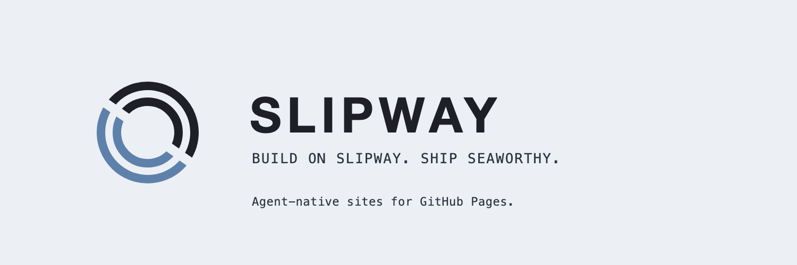

<p align="center">
  <picture>
    <source media="(prefers-color-scheme: dark)" srcset="brand/exports/banner-dark.png">
    
  </picture>
</p>

# Slipway

[](https://securityscorecards.dev/viewer/?uri=github.com/arminazimi/slipway)

**Build on Slipway. Ship Seaworthy.**

Sites that agents can edit safely, and prove it. Slipway is three things:

- **A docs engine, Mizzen** (`@velella/mizzen`). It builds a Markdown folder into a fast static site, with a source map from every block back to its file and line, a Markdown twin of every page, `llms.txt`, search, and a build that fails on a broken link.
- **A theme, Lateen** (`@velella/lateen`). An editorial, right-to-left-ready theme with design tokens, doc layouts, and content components. Every component works without JavaScript.
- **An open spec and its checker.** The agent-editable site spec says what a site publishes so an agent can edit it safely; `slipway doctor` checks any static site against it, whatever generator built it.

> **Status: alpha.** The engine, the theme, and the doctor work; `0.3.0` is the first release on the engine. `1.0.0`, the first stable release, is planned for 2027-02-14; see [ROADMAP.md](ROADMAP.md).

## What makes it different

- **Source maps.** Every finding points at the Markdown file and line to edit, not the built HTML. See [how source maps work](docs/source-maps.md).
- **Edit with your agent.** Every section offers a prompt with its source file, line, and current text.
- **`slipway doctor`.** Checks any static site against the agent-editable spec, with findings on the source line, as JSON and SARIF, in a GitHub Action, and as an MCP tool.
- **WebMCP** (experimental). Every site exposes search and page content as tools to browser agents.
- **Agent-native output.** `llms.txt`, Markdown twins of every page, JSON-LD, and an `AGENTS.md` in every site.
- **Content schemas.** Front matter and `mizzen.yml` have JSON Schemas, so agents and editors catch mistakes early.
- **Agent Skill and MCP server** for common changes: add a post, add a page, change the theme, verify.
- **Right-to-left done properly.** Persian and Arabic look designed, not mirrored.
- **Stable by contract.** The public API follows semver; renamed keys warn before they break.
- **Migration.** `slipway migrate` moves a 0.2 Jekyll site to the engine.

## Get started

```sh
npx create-slipway my-docs
cd my-docs
npx slipway build
```

A site is a folder of Markdown and one `mizzen.yml`. See [examples/docs](examples/docs) for a small site and [examples/product-docs](examples/product-docs) for a large one, the [docs](docs/) for the guides, and [UPGRADING.md](UPGRADING.md) if you have a 0.2 site on `remote_theme`: the Jekyll theme lives on in the `legacy/jekyll` branch and the `v0.2.0` tag.

## Relationship to Seaworthy

Slipway works without [Seaworthy](https://github.com/arminazimi/seaworthy) and integrates with it after 1.0. Seaworthy asks "is this site healthy and readable by agents?"; Slipway's spec asks "can an agent edit this site safely?". The integration plan is in [ROADMAP.md](ROADMAP.md#slipway-and-seaworthy). Why the two are separate projects: [ADR 0001](docs/adr/0001-why-slipway.md); why 1.0 is standalone: [ADR 0011](docs/adr/0011-standalone-and-the-spec.md). What a site may rely on across versions: [ADR 0012](docs/adr/0012-public-api.md).

## Contributing

Every planned task is a small issue with a lane and a size. Start with [CONTRIBUTING.md](CONTRIBUTING.md). Agents: read [AGENTS.md](AGENTS.md).

## Brand

The mark, palette, badge, favicons, and social art are in [brand/](brand/). Rules for using the name and logo: [brand/USAGE_POLICY.md](brand/USAGE_POLICY.md).

## License

[MIT](LICENSE)
