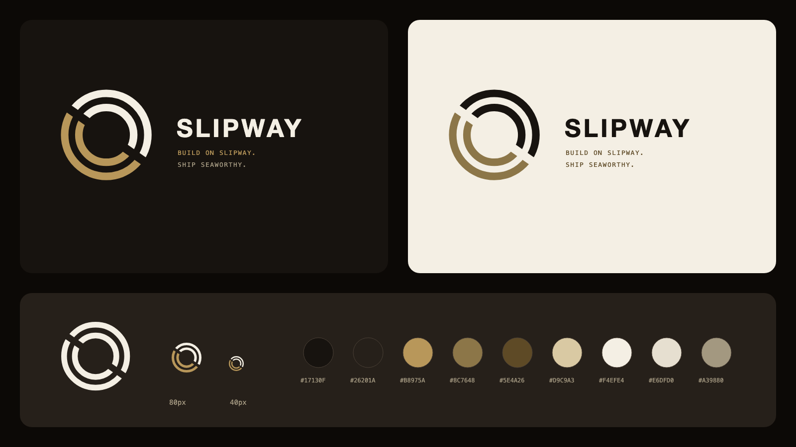

# Brand

Slipway's name, mark, palette, badge, and favicons. **Tagline:** Build on Slipway.



Start with [BRAND_GUIDE.md](BRAND_GUIDE.md).

| Path | What |
| --- | --- |
| [`BRAND_GUIDE.md`](BRAND_GUIDE.md) | Logo rules, color, type, badge, voice |
| [`USAGE_POLICY.md`](USAGE_POLICY.md) | When the name and logo may be used, and by whom |
| [`tokens.json`](tokens.json) · [`tokens.css`](tokens.css) | Colors, fonts, spacing: the source and its CSS |
| [`assets/`](assets/) | Mark in four variants (SVG and PNG) and the built-with badge |
| [`favicon/`](favicon/) | Simplified mark for 16 to 48 px: SVG, .ico, PNGs, Apple touch icon, manifest icons |

Everything except `tokens.json` and the Markdown files is generated:

```bash
npm run build:brand     # SVGs and tokens.css
npm run export:brand    # PNGs and the .ico (needs Chrome or Chromium)
```

`npm run check` fails when generated files drift from their source in `tools/brand/`.
